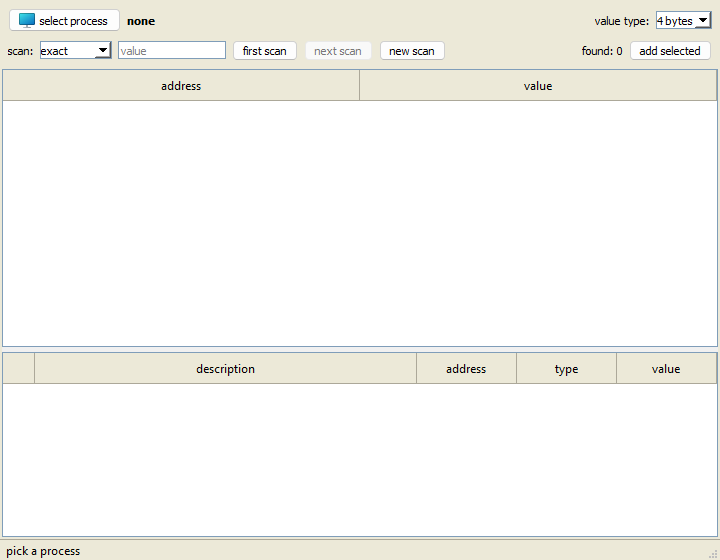

# peek

a tiny memory scanner for windows, written in python with ctypes. basically
a diet cheat engine - attach to a process, scan its writable memory for a
value, narrow it down with next scans, then watch/edit/freeze the addresses
you found.

wanted to learn how tools like this actually work instead of just using
them. turns out its mostly `VirtualQueryEx` to walk the memory map,
`ReadProcessMemory` to peek, `WriteProcessMemory` to poke. everything else
is bookkeeping.

run it:

```
py -3.14 peek.py
```

needs PySide6. you need to be able to open the target process - same user
is usually enough, protected/system stuff wont open.

## what it does

- process picker (name + pid, with a filter box)
- first scan for an exact value - 4 bytes, 8 bytes, float, double, or byte
- next scans: increased / decreased / changed / unchanged / exact
- results table with live addresses (shows first 500)
- address table at the bottom - add results, give them names, edit values
  by typing, check the box to freeze a value (rewritten every 300ms)
- watched addresses refresh every 500ms so you see live changes



## how it works

the scan walks every committed private writable region of the target with
`VirtualQueryEx`, reads it in 4mb chunks with `ReadProcessMemory`, and
uses `bytes.find` to hunt for the packed value - turns out the boring
built-in string search is fast enough that you dont need anything clever.

filter scans keep the address set from before and only re-read the regions
those addresses live in, so theyre way faster than the first scan.

freeze just writes the packed value back on a timer. that is the entire
cheat engine trick, it is not magic.

## limits

- 64 bit processes only (reads pointers as 64 bit)
- float scans match exact bits - a float displayed as "3.0" might really
  be 3.0000001 so scan "changed/unchanged" instead if exact misses
- only scans private writable memory (where your variables live) - not
  mapped files or image memory
- first scans on big processes take a few seconds, its python not c++
- no pointer scans, no disassembly, no debugging - just the memory part
